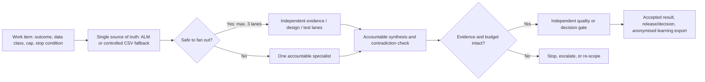

# Adaptive Harness and Information Flow

## Purpose and Boundary

This controlled configuration translates proven operating patterns into small, safe Triton_AI_Corp execution harnesses. It is not a claim that one company's method fits every task. Product and customer delivery stays in its separate product workspace; this Triton_AI_Corp repository holds only the reusable configuration and anonymised learning.

## Evidence-Based Design Choices

| Pattern adopted | Evidence | Triton adaptation |
| --- | --- | --- |
| Customer outcome before solution | AWS describes Amazon's Working Backwards process as starting with a PR/FAQ that makes customer value and assumptions explicit. | Every material workflow begins with a decision question, outcome, acceptance evidence, and a stop condition. |
| One written source and asynchronous default | GitLab documents asynchronous text communication, records conclusions, and a single source of truth. | The ALM item (or the controlled CSV fallback while ALM is unavailable) is the only status source; chat is an alert or discussion channel. |
| Pull, visible work, and quality at the source | Toyota's Just-in-Time limits work to what is needed; jidoka stops a line on abnormality to prevent defective downstream output. | Only the next required slice is pulled. A failed gate stops propagation and creates a named remediation item rather than more parallel drafting. |
| Small batches, WIP limits, and feedback | DORA identifies small batches, WIP limits, value-stream visibility, and fast feedback as capabilities associated with higher delivery performance. | A harness may run at most three independent lanes; each lane is time- and cost-bounded, then converges in one accountable synthesis. |
| Objective release/reliability trade-off | Google SRE uses SLOs and error budgets to permit releases while reliability is within the agreed budget and to pause changes when it is not. | Operational work has an explicit quality or error budget and a continue/limit/pause gate. |

Sources: [AWS DevOps Guidance](https://docs.aws.amazon.com/wellarchitected/latest/devops-guidance/oa.ti.6-prioritize-customer-needs-to-deliver-optimal-business-outcomes.html), [GitLab Communication Handbook](https://handbook.gitlab.com/handbook/communication/), [Toyota Production System](https://www.toyota-global.com/company/history_of_toyota/75years/text/entering_the_automotive_business/chapter1/section4/item4.html), [Google DORA capabilities](https://docs.cloud.google.com/architecture/devops), and [Google SRE error budgets](https://sre.google/sre-book/embracing-risk/).

## Common Information Flow

Parallel work is for genuinely independent questions only. Dependencies, source data, assumptions, and the final decision never fan out without a named integration owner.

Task sizing and merge/split decisions follow `TASK_GRANULARITY_AND_PARALLELISATION_POLICY.md`; workflow metrics may propose a bounded trial but never mutate routing automatically.

Process depth follows `LEAN_ASSURANCE_AND_PROCESS_TAILORING_POLICY.md`. Define the applicable obligations and quality contract first, then use the least intensive `LEAN`, `STANDARD`, or `ASSURANCE` route that can produce objective acceptance evidence. The configured default needs no separate tailoring ceremony; record only material deviations, substitutions, assurance-route changes or interpretations of binding obligations.

## Cost and Data Guardrails

1. Do not start an external-model lane without provider approval, data classification, a token or monetary cap, and a stop condition recorded in the work item.
2. Limit a harness to three concurrent lanes, two model calls per lane, and one synthesis call. This creates a maximum of seven model calls before a gate; it is a ceiling, not a target.
3. Reuse one approved evidence capsule across lanes. Do not send full graph state or duplicate context independently to each model.
4. Stop further fan-out when a gate fails, evidence conflicts, a cap is reached, or a material privacy, security, safety, legal, or delivery risk appears.
5. For sensitive data, cross-border processing, or material change, apply the controlled route and human accountable approval before external processing. The catalog does not override project data-flow approval.

## Workflow Selection

The executable catalog is `ADAPTIVE_HARNESS_CATALOG.json`; `adaptive_harness.py` validates and exposes a selected plan.

| Work type | Harness | Parallel lanes after a clear frame | Convergence gate |
| --- | --- | --- | --- |
| Discovery / offer / research | Customer evidence, feasibility, economics | Up to three | Product Owner option decision |
| Coding | Implementation, test design, architecture check | Up to three | Code Validator with fail-closed result |
| System architecture | Solution alternatives, assurance, integration | Up to three | Architect decision record and required approval |
| Regulated engineering | System/architecture, safety/quality, security/privacy/operations | Up to three | Domain applicability, independent assurance, and named human release gate |
| Built environment | Design, engineering, cost/execution | Up to three | Independent site-quality review; qualified human sign-off as required |
| Service operation | Operations, quality, customer impact | Up to three | Release owner continues, limits, or pauses change |

## Measurement and Improvement Loop

Measure only at workflow level: decision latency, accepted first-pass rate, rework, blocked-work age, hand-off completeness, cost-cap consumption, and quality/reliability guardrails. Compare a changed harness against the prior approach on similar work. The Continuous Improvement Architect may propose one reversible micro-trial; it must not silently change production routing.
