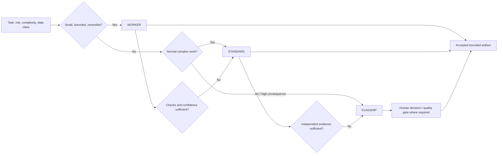

# Model Classes and Benchmark Admission Policy

## Decision

Triton_AI_Corp uses three capability-and-cost classes. A class is assigned to a specific **model version and provider route**, not to a brand family. Public leaderboards provide a current screening signal; Triton's representative acceptance suite provides the release decision. Neither benchmark status nor a class label authorises data transfer.

| Class | Primary purpose | Routing principle |
| --- | --- | --- |
| `FLAGSHIP` | Difficult reasoning, architecture, high-consequence synthesis, final review | Use selectively after framing; do not waste it on routine production. |
| `STANDARD` | Everyday complex work, reviews, structured writing, reliable fallback | The normal quality/cost balance for non-trivial tasks. |
| `WORKER` | Narrow, reversible production tasks such as extraction, grammar, formatting, classification and drafts | Lowest adequate cost; deterministic or independent review before material use. |

## Recognised Benchmark Signals

- [Artificial Analysis capability-index methodology](https://artificialanalysis.ai/methodology/capability-indices) supplies independently run capability comparisons and price/latency context.
- [LMArena](https://lmarena.ai/) provides a blinded, human-preference signal based on pairwise comparisons. It is useful for open-ended assistance but is not a substitute for task-specific evaluation.
- [Hugging Face leaderboards and evaluations](https://huggingface.co/docs/leaderboards/main/index) provide reproducible open-model evaluation evidence with disclosed benchmark provenance.

No single score is sufficient. Benchmark rankings vary with version, prompting method, context length, harness, and the relevant task. A coding agent score is not automatically a score for direct code generation; a conversation ranking is not a legal, safety, or privacy assurance.

## Admission Procedure

1. Record the exact model version, provider endpoint, processing region, price-card date, context configuration, and permitted data classes.
2. Capture at least two current external signals with score, rank, total entries, snapshot date, and URL. One must match the intended task class.
3. Run at least ten data-safe Triton acceptance cases for that intended class. Capture quality, deterministic-check result, latency, actual cost, and critical failures.
4. Apply the threshold in `MODEL_CLASS_REGISTRY.json`. A failure, a changed model version, or a material provider/configuration change resets admission.
5. Obtain the Model Quality Observer recommendation and the required privacy, security, commercial and human approvals before activation.

## Information and Escalation Flow

The routing decision is strengthened, never weakened, by sensitive data or material risk: only an approved data route and the applicable human gate can permit processing. Online escalation remains local first, then approved EU/EEA, and only then a documented exception.

## Cost Controls

- A work item selects the lowest class that can meet its acceptance criteria.
- Each external call uses the already approved compact data capsule and its token or monetary cap.
- Worker fan-out may produce drafts, but only the synthesis and required review proceed to a higher class.
- Repeated Worker failure is a signal to re-frame or route up once; it is not permission for unlimited retries.
- Class assignment and routing are reviewed after comparable work; accepted quality, rework, latency, and actual cost are measured together.

## Current State

`gemma3:4b` and `qwen3:4b` are labelled as **local Worker candidates** with bounded intended strengths and explicit limits in the registry. They are not admitted class members until their Triton acceptance cases are complete. Their model origin does not change their processing route: an Ollama run on the XPS remains `LOCAL_DEVICE_ONLY` and does not send data to the United States or China.

No US- or China-hosted model is preselected. These are labelled only as `US_EXCEPTION` and `CN_EXCEPTION` processing routes; each needs its own provider, model version, data capsule, legal/privacy review, price cap, and human approval. The prior `primary`, `specialist`, and `validator` settings describe graph roles, not benchmark-qualified capability classes. The local `phi4-mini:3.8b` reference is obsolete because the model was removed; do not activate it as a validator.
