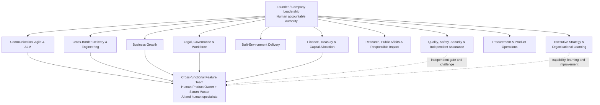

# Triton Organisation Chart and Hybrid Operating Model

## Organisation Chart

Departments maintain specialist capability; feature teams deliver a customer or product outcome. The matrix is deliberate: a Feature Team receives capacity from the relevant departments, while Quality, Security, Privacy, Legal, and Finance retain the right to challenge or gate work independently.

## Human and AI Responsibility

The chart does not make an AI role a legal person, line manager, or final authority. Every active team and governance meeting has a named human accountable owner. A trained human AI Pod Steward can coordinate several AI roles, provided authoring and independent validation are separated for material decisions.

| Layer | Accountable party | Typical work |
| --- | --- | --- |
| Direction and commitments | Founder or delegated human leader | Strategy, contracts, risk acceptance, budget, customer promises |
| Team outcome | Human Product Owner / Delivery Lead | Backlog order, scope, delivery coordination, escalation |
| AI pod operation | Human AI Pod Steward | Task boundaries, evidence review, safe delegation, stop decision |
| Independent assurance | Authorised human quality, security, privacy, legal, or finance gate owner | Evidence review and gate decision |

## Teams and Scaling

Start with a small human-led feature team and a small agent pod. Add agents or people only when the hand-off, review capacity, quality evidence, and customer value support it. A larger multi-team product may use Nexus integration practices, but approved SAFe governance decides cross-team priorities and escalations.

## Canonical Sources

- `ROLE_REGISTRY.json` is the authoritative role inventory.
- `AGENT_PERSONA_REGISTRY.json` assigns functional call signs and styles.
- `HUMAN_AGENT_STEWARDSHIP_AND_RELIABILITY_POLICY.md` defines delegation and reliability evidence.
- `05_Human_Interface_and_Ops/Human_Employee_Documents/HUMAN_AI_COMPANY_ACADEMY.md` defines human training.
